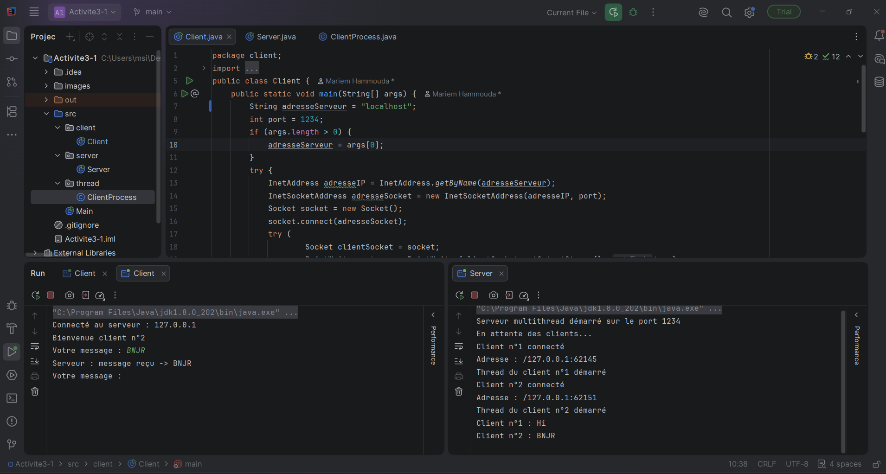
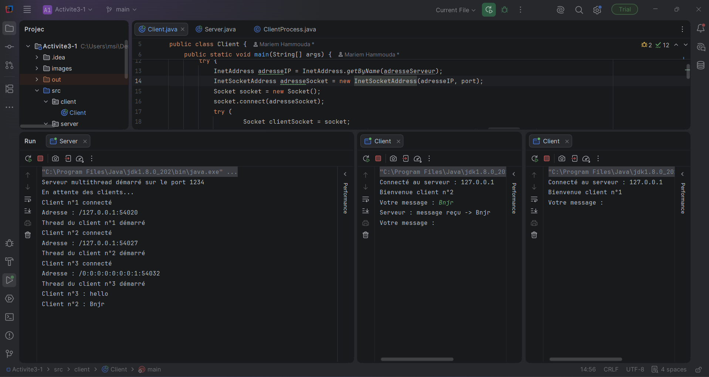
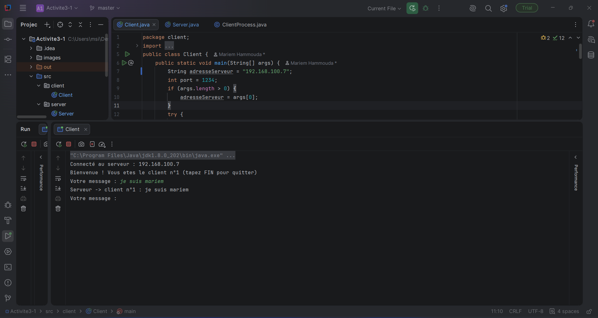
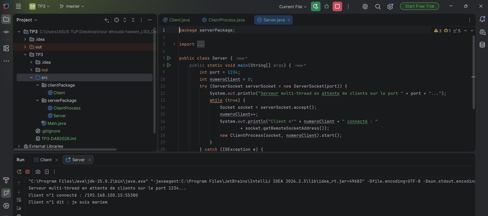
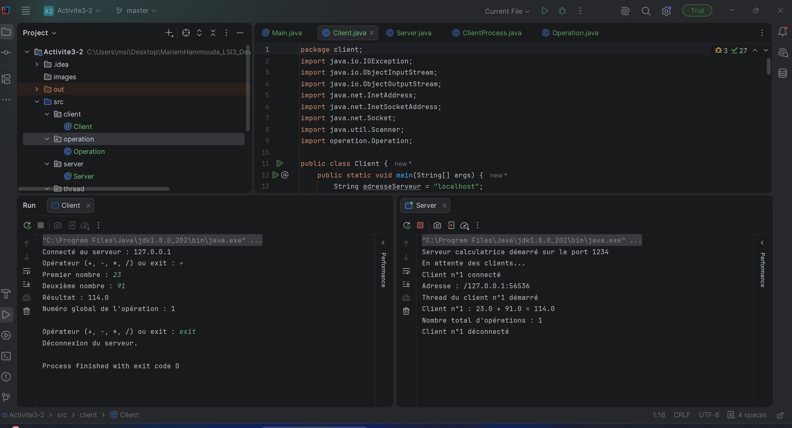
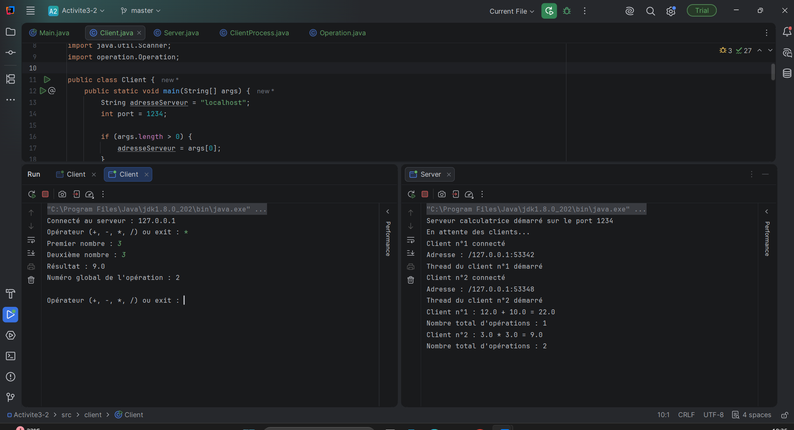
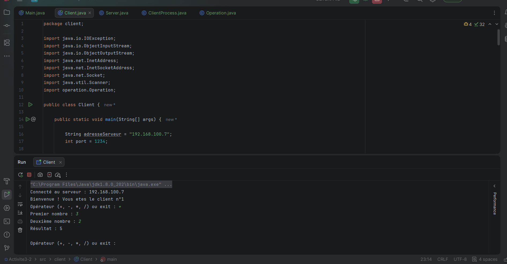
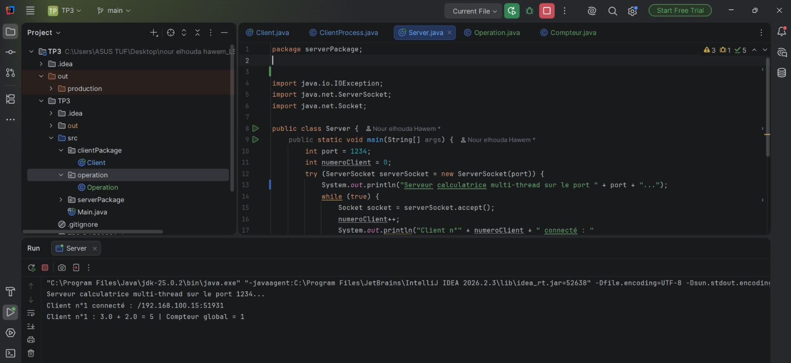

# TP3 : Serveur Multi-threads — Sockets en mode connecté TCP

**Module :** Développement d'applications réparties (DAR)  
**Niveau :** LSI3  
**Année universitaire :** 2026–2027  
**Langage :** Java  
**Protocole :** TCP  
**Environnement :** JDK, IntelliJ IDEA, Git et GitHub

---

## 1. Présentation du TP

Ce TP consiste à améliorer les applications client/serveur développées dans les TP précédents afin de permettre à un serveur Java de gérer plusieurs clients simultanément grâce au multithreading.

Le travail est divisé en deux activités :

- **Activité 3-1 :** Acceptation de plusieurs clients.
- **Activité 3-2 :** Amélioration de l'application calculatrice et gestion d'un compteur global.

## 2. Objectifs

- Comprendre le fonctionnement des sockets TCP en Java.
- Développer un serveur multithread capable d'accepter plusieurs clients.
- Créer un thread dédié à chaque client connecté.
- Afficher l'adresse du client et son numéro de connexion.
- Envoyer un message de bienvenue à chaque client.
- Réaliser une communication client/serveur par objets Java.
- Permettre à plusieurs clients d'utiliser simultanément une calculatrice.
- Gérer un compteur global partagé entre plusieurs threads.
- Synchroniser l'accès au compteur pour éviter les conflits.
- Tester la communication en local et sur un réseau local.

## 3. Environnement de développement

- **Langage :** Java
- **JDK :** compatible avec les fonctionnalités utilisées du JDK 8 ou supérieur
- **IDE :** IntelliJ IDEA
- **Protocole réseau :** TCP
- **Communication :** sockets et objets Java sérialisables
- **Gestion de versions :** Git et GitHub

## 4. Organisation du projet

Le projet est organisé en quatre packages :

```text
```text
TP3/
├── Activite3-1/
│   ├── src/
│   │   ├── client/
│   │   │   └── Client.java
│   │   ├── server/
│   │   │   └── Server.java
│   │   └── thread/
│   │       └── ClientProcess.java
│   │
│   └── images
│
├── Activite3-2/
│   ├── src/
│   │   ├── client/
│   │   │   └── Client.java
│   │   ├── server/
│   │   │   └── Server.java
│   │   ├── thread/
│   │   │   └── ClientProcess.java
│   │   └── operation/
│   │       └── Operation.java
│   │
│   └── images
│
│
└── README.md

```

### Rôle des classes

| Classe | Rôle |
|---|---|
| `client.Client` | Établit la connexion avec le serveur et échange les messages ou les opérations. |
| `server.Server` | Écoute les connexions TCP et attribue un numéro à chaque client. |
| `thread.ClientProcess` | Gère la communication avec un client dans un thread indépendant. |
| `operation.Operation` | Représente une opération arithmétique et contient son résultat, son éventuelle erreur et son numéro. |

## 5. Activité 3-1 : Acceptation de plusieurs clients

### 5.1. Principe de fonctionnement

Le serveur utilise un `ServerSocket` pour écouter les connexions sur le port `1234`.

Lorsqu'un client se connecte :

1. Le serveur accepte la connexion.
2. Il attribue un numéro d'ordre au client.
3. Il affiche son adresse réseau.
4. Il crée un objet `ClientProcess`.
5. Le thread démarre et gère les échanges avec ce client.

Cette organisation permet au serveur de continuer à accepter de nouvelles connexions pendant que les threads existants communiquent avec leurs clients.

### 5.2. Démarrage du serveur

Le serveur est lancé avant les clients et attend les connexions entrantes.
**Synthèse :** Le serveur démarre sur le port TCP 1234 et se met en attente des connexions clientes.

### 5.3. Connexion de plusieurs clients

Plusieurs clients Java sont lancés sans arrêter le serveur ni fermer les autres connexions.

**Capture 2 — Connexion de plusieurs clients**



**Synthèse :** Le serveur accepte plusieurs clients et affiche, pour chacun, son numéro d'ordre et son adresse distante.


### 5.4. Tests locaux

Les tests locaux sont réalisés sur la même machine en lançant le serveur et plusieurs clients Java.

La commande Telnet prévue dans l'énoncé est :

```cmd
telnet localhost 1234
```

**Capture 4 — Test local**



**Synthèse :** Les tests permettent de vérifier l'établissement de plusieurs connexions sur le port 1234.

**Remarque :** Le client de l'activité 3-1 utilise des messages texte avec `PrintWriter` et `BufferedReader`. Telnet peut donc être utilisé avec cette version du serveur. En revanche, le client de l'activité 3-2 utilise des objets Java sérialisés et nécessite le protocole correspondant.

###### 5.5 Test de communication entre deux PC
Pour vérifier le fonctionnement du serveur TCP dans un réseau local, nous avons réalisé un test avec deux ordinateurs.
**Configuration :**
- **PC de mon amie (serveur) :** exécution de `Server.java` sur le port `1234`.
- **Mon PC (client) :** exécution de `Client.java`, configuré avec l'adresse IPv4 du PC de mon amie.
- **Protocole :** TCP.
- **Port utilisé :** `1234`.

#### Étape 1 : Démarrer le serveur sur le PC de mon amie

Mon amie lance `Server.java`. Le serveur attend les connexions des clients sur le port 1234.

#### Étape 2 : Configurer le client sur mon PC

Dans `Client.java`, nous remplaçons `localhost` par l'adresse IPv4 du PC de mon amie :

```java
String adresseServeur = "ADRESSE_IP_DU_PC_SERVEUR";
```

L'adresse doit être remplacée par l'adresse IPv4 réelle obtenue avec la commande `ipconfig` sur le PC de mon amie.

#### Étape 3 : Tester la communication

Je lance `Client.java` sur mon PC. Une fois la connexion établie, le client reçoit un message de bienvenue, envoie des messages au serveur et reçoit les réponses correspondantes.

#### Captures d’écran — Communication entre deux PC



#### Synthèse
Ce test permet de vérifier que le serveur TCP accepte une connexion provenant d'un autre ordinateur du réseau local. Il confirme que les échanges de messages entre le client et le serveur fonctionnent à travers le réseau.

## 6. Activité 3-2 : Amélioration de l'application calculatrice

### 6.1. Principe de fonctionnement

L'application calculatrice est améliorée afin de permettre à plusieurs clients d'envoyer des opérations au serveur simultanément.

La communication repose sur les sockets TCP et les flux `ObjectInputStream` et `ObjectOutputStream`.

Le client construit un objet `Operation` contenant :

- Le premier opérande.
- L'opérateur arithmétique.
- Le deuxième opérande.

Le serveur récupère l'objet, effectue le calcul, met à jour les informations de l'opération et renvoie l'objet au client.

### 6.2. Opérations prises en charge

La calculatrice permet d'effectuer les opérations suivantes :

| Opérateur | Opération |
|---|---|
| `+` | Addition |
| `-` | Soustraction |
| `*` | Multiplication |
| `/` | Division |

Le programme prévoit également la gestion des opérateurs invalides et de la division par zéro.

### 6.3. Test d'une opération

**Capture 5 — Exécution d'un calcul**



**Synthèse :** Le client envoie une opération au serveur. Le serveur effectue le calcul et renvoie l'objet `Operation` contenant le résultat ou le message d'erreur.

### 6.4. Connexion simultanée de plusieurs clients

Plusieurs clients se connectent au serveur et effectuent des calculs indépendamment.

**Capture 6 — Calculatrice multiclient**



**Synthèse :** Chaque client est pris en charge par un thread indépendant, ce qui permet au serveur de traiter plusieurs connexions.
## 7. Tests en réseau local

Le serveur est exécuté sur un ordinateur et les clients sur d'autres machines connectées au même réseau local.

Dans le client, l'adresse du serveur est définie par la variable `adresseServeur`. L'utilisation de `InetAddress` et `InetSocketAddress` permet de résoudre l'adresse et d'établir la connexion TCP.

Le port utilisé est `1234`.

**Capture 8 — Communication sur le réseau local**




**Synthèse :** Ce test vérifie que les clients peuvent se connecter à un serveur distant et effectuer des calculs à travers le réseau local.

## 9. Bilan

Ce TP a permis de mettre en pratique la communication client/serveur avec les sockets TCP en Java et de comprendre le fonctionnement d'un serveur multithread.

L'activité 3-1 a permis de gérer plusieurs connexions clientes grâce à la création d'un thread dédié à chaque client.

L'activité 3-2 a permis d'intégrer une calculatrice basée sur l'échange d'objets Java, de gérer les erreurs de calcul et de partager un compteur global entre plusieurs threads.

Enfin, la synchronisation du compteur contribue à garantir la cohérence des données partagées lors de traitements concurrents.

